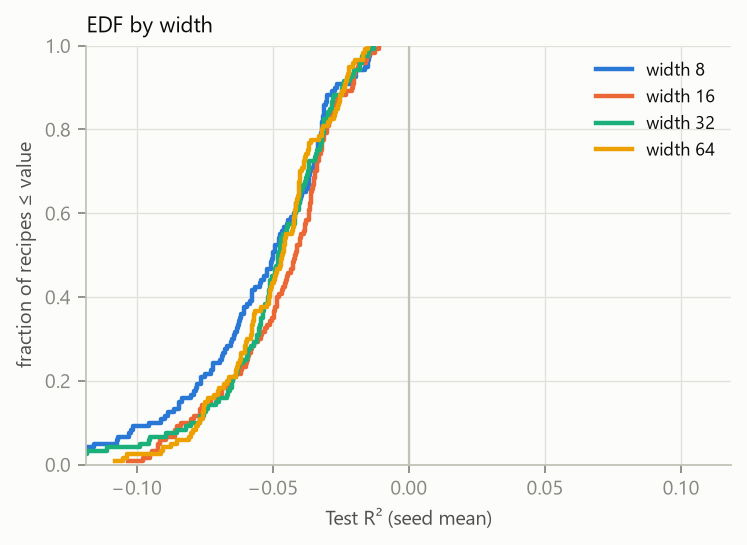
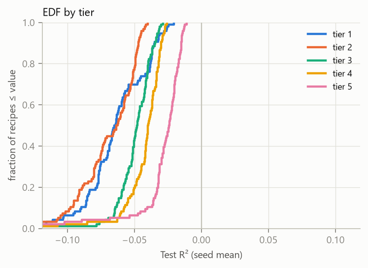

# Capacity study: what do training-saturated MLPs learn from stock prices?

A controlled study of how depth, width, regularization and the amount of training data change what a small
MLP learns, when every network is tuned and trained to the end of its learning curve. Each of **480 recipes**
gets its own hyperparameter search and **32 independent seeds**, so every reported effect comes with its
seed-to-seed spread. In total that is about 46,000 training runs, executed on two consumer AMD GPUs.

The spec is [docs/PROJECT_BRIEF.md](docs/PROJECT_BRIEF.md), explained for readers in
[docs/PROJECT_GUIDE.md](docs/PROJECT_GUIDE.md). [docs/README.md](docs/README.md) maps the docs to the code.

## The setup

| | |
|---|---|
| **Task** | From the last 16 daily closes of a US stock, predict the next day's log close. Scored as out-of-sample R² of the implied return against **persistence** (predicting no change), on a fixed test asset (JPM) over the last 2 years. |
| **Input** | Each window is normalized by its own mean and std, then encoded as 15 Haar wavelet details, 2 short-horizon volatilities and the window statistics (19 features). |
| **Recipe grid** | depth {1, 2, 4, 8} × width {8, 16, 32, 64} × weight decay {off, on} × data tier {1, 4, 12, 24 financials, 24 mixed-sector} × history {3, 7, 18 years}: 750 to 108,720 training windows |
| **Training** | Plain leaky-ReLU MLP, schedule-free AdamW, 500 epochs × 25 steps |
| **Tuning** | Per recipe: a calibration run sets the search ranges, then 16 Halton-sampled trials × 4 seeds, scored on a held-out validation window |
| **Final stage** | 32 seeds per recipe, retrained on train + validation data and evaluated on the untouched test window |
| **Analysis** | Per-recipe test R², generalization gap, seed variance and saturation status. Recipes are merged into connected regions of statistically equivalent results, so no borders are chosen by hand. |

## What it found (run `main-v3`)

**No recipe beats persistence.** Test R² is negative for all 480 recipes (median −0.047, best −0.011). Under
the tuning protocol, every network converges to something close to "predict no change" plus noise.

**Capacity barely matters; data does.** Moving any one capacity factor across its full range changes median
test R² by at most 0.008. Moving from one asset to 24 mixed-sector assets changes it 5× more: from −0.064 to
−0.024, and the generalization gap halves (0.130 → 0.066).

<p align="center">
  
  <br>
  <em>Distribution of test R² across recipes. Left: by width, where the curves overlap. Right: by data tier,
  where each curve shifts toward zero. The gray line is persistence.</em>
</p>

| Factor | Median test R² by option | Spread |
|---|---|---|
| depth 1 / 2 / 4 / 8 | −0.047 / −0.049 / −0.045 / −0.043 | 0.007 |
| width 8 / 16 / 32 / 64 | −0.050 / −0.042 / −0.048 / −0.047 | 0.008 |
| weight decay off / on | −0.046 / −0.047 | 0.001 |
| history 3 / 7 / 18 years | −0.046 / −0.058 / −0.039 | 0.019 |
| **data tier 1 → 5** | **−0.064 / −0.063 / −0.048 / −0.040 / −0.024** | **0.040** |

**Validation tuning becomes early stopping.** With a fixed step budget, the learning rate decides how far the
weights move. When the inputs carry almost no signal, the best validation score belongs to the network that
learns least beyond persistence. So the tuner picks tiny learning rates (median 5.8e-5), and they shrink as
width grows (2.5e-4 at width 8, 2.8e-5 at width 64). This is why almost no recipe can show up as overfit:
470 recipes are valid and 10 failed to saturate (mostly width 8 with 3 years of history).

**What changes next.** A base learner that only reproduces persistence is useless for the downstream ensemble
this study feeds. A preliminary signal scan found that next-day realized volatility carries 10–100× more
learnable signal than next-day returns. The next iteration removes weight decay and replaces validation
tuning with a fit objective that produces saturated networks. It is also deciding whether to switch the target
to volatility.

## Engineering

- **Batched training.** One job trains 64–128 models as a single stacked network (`bmm`). The data stays on the
  GPU for the worker's lifetime, and nothing is copied back to the host per step.
- **Batched schedule-free AdamW.** A vectorized port of `schedulefree.AdamWScheduleFree` with per-model learning
  rate and weight decay. Tests check it model by model against the pinned reference package.
- **Crash-safe job queue.** A SQLite ledger with heartbeats and a checkpoint every 25 epochs. After a crash or
  power loss, a resumed job reproduces an uninterrupted run bit for bit. `DONE.json` is written last, and
  completed jobs are never overwritten.
- **Traceable results.** Workers refuse a dirty git tree unless overridden, and the diff is recorded. Every
  result-affecting value lives in `configs/*.toml` with no defaults in code. Raw prices are committed with a
  sha256 manifest.
- **Scheduling on small GPUs.** `bench` measures throughput, and a memory-budget rule keeps large jobs to two per
  8 GB GPU. The full study runs in about 4.6 hours on two RX 6650 XT GPUs (ROCm on Windows), plus 17 minutes of
  calibration.
- **Docs that can't drift.** Each guide chapter records a hash of the brief section it explains, and
  `tests/test_docs.py` fails when a section changes without its chapter being reviewed.

## Running the study

All commands are `uv run python -m capacity_study <command> ...`. Commit the code first: workers refuse a dirty
tree unless `--allow-dirty`.

```
fetch-data   --config configs/study.toml                 # one time; data/raw/ is committed, never refetched
prepare      --config configs/study.toml                 # feature bank -> cache/
init-study   --config configs/study.toml --study runs/main
bench        --study runs/main --device cuda:0           # pick --workers-per-device from steady-state throughput

enqueue      --study runs/main calibration
launch       --study runs/main --devices cuda:0,cuda:1 --workers-per-device W
freeze-ranges --study runs/main                          # after calibration completes; writes ranges.json once
enqueue      --study runs/main tuning                    # adds tuning + final jobs (final waits on its tuning job)
launch       --study runs/main --devices cuda:0,cuda:1 --workers-per-device W
```

Control while running:

```
status  --study runs/main
pause   --study runs/main          # workers checkpoint at the next epoch end and exit (Ctrl+C does the same)
resume  --study runs/main --devices cuda:0,cuda:1 --workers-per-device W
retry   --study runs/main <job_id> # failed jobs are never retried automatically
```

A crash or power loss loses at most one checkpoint interval (25 epochs) of one job. `launch` returns jobs
without a recent heartbeat to the queue.

## Layout

- `src/capacity_study/`:
  - `data/`: fetch, Haar features, feature bank, splits
  - `model.py`: stacked MLP
  - `optim.py`: batched schedule-free AdamW port
  - `train.py`: one job
  - `tuning.py`
  - `ledger.py`: SQLite queue
  - `orchestrate.py`: study lifecycle, worker, launcher
  - `bench.py`, `cli.py`
- `configs/study.toml`: every result-affecting value.
- `runs/<study>/` (not committed): `study.json`, `ledger.sqlite`, `ranges.json`, and `jobs/<job_id>/` holding
  `job.json`, `events.jsonl`, `metrics/`, `preds/`, `tuning/`, weights, and `DONE.json` (written last).
  `analysis/<commit>/` holds the derived tables and figures.

## Tests

`uv run pytest` runs 41 tests; the GPU tests run when a GPU is visible. They cover features and splits, the
optimizer port, tuning, the job store, the pipeline, analysis, and brief/guide sync.
